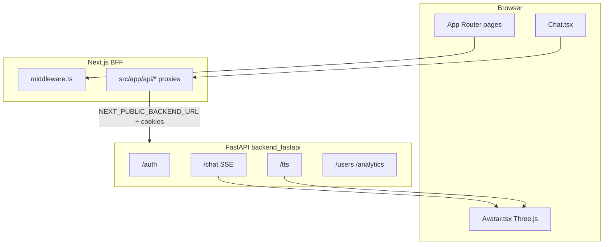
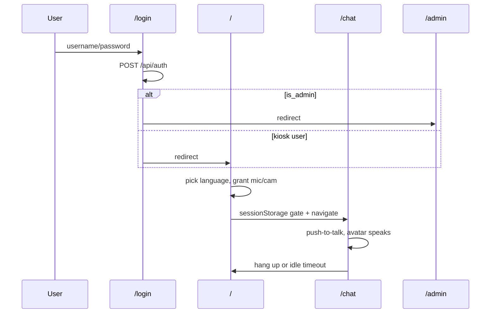
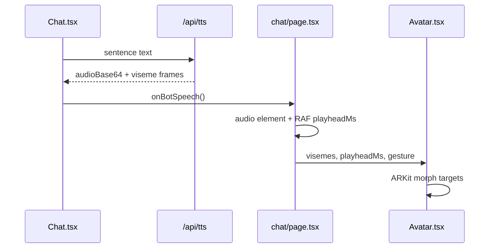

# AI Concierge — Frontend

Marina Square AI Concierge kiosk UI — a Next.js app with a 3D talking avatar, bilingual chat, and admin dashboard.

For full-stack setup (Docker, GCP credentials, CI/CD), see the [root README](../README.md).

---

## Table of Contents

1. [Overview](#1-overview)
2. [Quick Start](#2-quick-start)
3. [Architecture](#3-architecture)
4. [User Journeys](#4-user-journeys)
5. [Features](#5-features)
6. [Folder Structure](#6-folder-structure)
7. [Key Components Reference](#7-key-components-reference)
8. [Infrastructure](#8-infrastructure)
9. [API Routes Reference](#9-api-routes-reference)
10. [Conventions for Contributors](#10-conventions-for-contributors)
11. [Troubleshooting](#11-troubleshooting)
12. [Related Docs](#12-related-docs)

---

## 1. Overview

The frontend is the **browser-facing layer** of the Marina Square AI Concierge. Visitors log in, pick a language on a lobby screen, then enter a kiosk chat session where they talk to a 3D avatar powered by Gemini and Google Cloud TTS.

**What the frontend owns:**

- Kiosk UI (lobby, in-call chat, toolbar, idle timeout)
- 3D avatar rendering and lip-sync (Three.js)
- Bilingual UI strings (English / Chinese)
- Admin dashboard (users, analytics, conversation history)
- Thin API proxies that forward requests to the FastAPI backend

**What the backend owns** (`backend_fastapi/`):

- JWT auth, user management, PostgreSQL
- Gemini chat (Vertex AI) with optional RAG grounding
- Google Cloud TTS and viseme generation
- Conversation persistence and analytics

### Tech Stack

| Layer | Technology |
|---|---|
| Framework | Next.js 16 (App Router), React 19, TypeScript 5 |
| 3D / Avatar | Three.js, `@react-three/fiber`, `@react-three/drei` |
| Styling | Tailwind CSS v4 |
| Markdown | `react-markdown` (bot messages, admin conversations) |
| Icons | `lucide-react` |
| Runtime | Node 20 (Docker) |

### Where This Fits in the Monorepo

```
avatar_chatbot/
├── frontend_nextjs/    ← you are here
├── backend_fastapi/    ← FastAPI (auth, chat, TTS, DB)
├── docker-compose.yml
└── docker-compose.dev.yml
```

---

## 2. Quick Start

### Prerequisites

- **Node.js 20** and npm
- A running **FastAPI backend** (chat, TTS, and auth will not work without it)

### npm Scripts

```bash
npm run dev     # Development server → http://localhost:3000
npm run build   # Production build (standalone output)
npm run start   # Run production build
npm run lint    # ESLint
```

### Run Modes

#### Recommended — full stack via Docker

From the repo root:

```bash
cp .env.example .env   # configure env vars (see root README)
docker compose -f docker-compose.dev.yml up
```

| Service | URL |
|---|---|
| Frontend | http://localhost:3000 |
| Backend API | http://localhost:8000 |

Hot reload is enabled — edit files in `frontend_nextjs/` and the dev server picks up changes automatically.

#### Frontend only — local `npm run dev`

```bash
cd frontend_nextjs
npm install
npm run dev
```

The UI loads, but `/api/*` routes proxy to FastAPI. Set the backend URL:

```bash
# In repo-root .env or shell
NEXT_PUBLIC_BACKEND_URL=http://localhost:8000
```

Start the backend separately:

```bash
cd backend_fastapi
uv run uvicorn main:app --reload
```

### Frontend Environment Variables

The frontend only reads **one** runtime variable:

| Variable | Default (Docker) | Purpose |
|---|---|---|
| `NEXT_PUBLIC_BACKEND_URL` | `http://backend:8000` | Base URL for all `/api/*` proxies |

All other env vars (GCP, JWT, database, TTS) are consumed by the backend. See the [root README](../README.md) for the full list.

---

## 3. Architecture

The frontend is a **kiosk UI + Backend-for-Frontend (BFF)**. Next.js API routes do not call Gemini or TTS directly — they forward requests to FastAPI and relay responses (including SSE streams) back to the browser.



### Layer Responsibilities

| Layer | Owns |
|---|---|
| Pages (`src/app/`) | Routing, layout, kiosk UX orchestration |
| Components | 3D avatar, chat UI, idle modals, admin shell |
| API routes (`src/app/api/`) | Thin proxies — forward body, cookies, SSE streams |
| Middleware | Cookie **presence** gate (not JWT validation) |
| Backend (external) | Auth, Gemini chat, TTS, users, analytics, DB |

### BFF Proxy Pattern

Every API route follows the same pattern: read the incoming request, forward it to FastAPI with cookies, return the upstream response.

Example — chat SSE passthrough (`src/app/api/chat/route.ts`):

```typescript
const BACKEND = process.env.NEXT_PUBLIC_BACKEND_URL ?? "http://backend:8000";

const upstream = await fetch(`${BACKEND}/chat`, {
    method: "POST",
    headers: { "Content-Type": "application/json", "Cookie": cookie },
    body,
});

return new Response(upstream.body, {
    status: upstream.status,
    headers: {
        "Content-Type": "text/event-stream",
        "Cache-Control": "no-cache",
        "Connection": "keep-alive",
    },
});
```

### Auth Model

Auth is split between middleware (cookie check) and backend (JWT validation):

| Layer | What it does |
|---|---|
| **Middleware** (`src/middleware.ts`) | Checks that an `auth-token` cookie **exists** on protected routes |
| **Backend** (`backend_fastapi`) | Decodes and validates the JWT on every API call |
| **Login** (`POST /api/auth`) | Forwards credentials → backend sets HTTP-only `auth-token` cookie (7 days) |

Redirect rules in middleware:

- Unauthenticated `/` or `/admin` → `/login`
- Unauthenticated `/chat` → `/` (lobby, not login — kiosk users may have timed out mid-session)
- Authenticated `/login` → `/` (lobby)

On 401 from chat or TTS, `Chat.tsx` clears the kiosk session gate and redirects to the lobby.

---

## 4. User Journeys

Three personas use the app: **kiosk visitors**, **admins**, and **developers** (you).



### Login (`/login`)

**File:** `src/app/login/page.tsx`

1. User submits username and password.
2. `POST /api/auth` → backend `POST /auth/login`.
3. Backend sets an HTTP-only `auth-token` JWT cookie.
4. Client calls `GET /api/auth/me` to check `is_admin`.
5. **Admin** → redirect to `/admin`.
6. **Everyone else** → redirect to `/` (lobby).

### Lobby (`/`)

**File:** `src/app/page.tsx`

Pre-call screen with Marina Square branding:

1. **Language picker** — `en-US` or `zh-CN`, stored in `sessionStorage` (`selectedLang`).
2. **Avatar preview** — static `<Avatar />` (no lip-sync props).
3. **Start Chat** — requests `getUserMedia({ audio: true, video: true })`.
   - On success: sets `KIOSK_CHAT_ENTRY_KEY` in `sessionStorage` → navigates to `/chat`.
   - On denial: shows localized error, still sets gate key and redirects after 1.8s.
4. **Logout** — `POST /api/auth/logout` → `/login`.
5. **Admin link** — shown if `/api/auth/me` returns `is_admin: true`.

On lobby mount, `KIOSK_CHAT_ENTRY_KEY` is cleared so a direct `/chat` URL cannot bypass the lobby.

### Chat (`/chat`)

**File:** `src/app/chat/page.tsx`

The in-call kiosk experience:

1. **Gate check** — if `sessionStorage` lacks `KIOSK_CHAT_ENTRY_KEY` → redirect to `/`.
2. **Split layout** — 3D avatar (left) + collapsible chat panel (right, 380px).
3. **Toolbar** — call timer, push-to-talk mic, chat toggle, captions, hang up.
4. **Idle reset** — configurable timeout from `GET /api/config`; 30s warning modal → auto-return to lobby or "stay active".
5. **Hang up** — navigates to `/`.

### Admin (`/admin`)

**Files:** `src/app/admin/`

Protected by the same middleware. Layout (`admin/layout.tsx`) checks admin status via `/api/auth/me`.

| Route | Purpose |
|---|---|
| `/admin` | Redirects to `/admin/users` |
| `/admin/users` | Paginated user list — create, reset password, delete |
| `/admin/analytics` | Stats cards, recent conversations, top users |
| `/admin/conversations/[id]` | Full message thread rendered with ReactMarkdown |

---

## 5. Features

### Bilingual UI

**Files:** `src/lib/locale.ts`

- Supported locales: `en-US`, `zh-CN`.
- Locale chosen on lobby → stored in `sessionStorage` (`selectedLang`).
- All UI strings accessed via `getLocaleStrings(locale)`.
- To add a new language: extend `SUPPORTED_LOCALES` and add a full string block for both lobby and chat.

### 3D Avatar + Lip-Sync

**Files:** `src/components/Avatar.tsx`, `src/types/viseme.ts`, `public/avatar/avatar_active.glb`

- Renders a bust-view 3D avatar using `@react-three/fiber` and `@react-three/drei`.
- Model loaded from `public/avatar/avatar_active.glb` (Streamoji-style GLB with ARKit morph targets).
- Lip-sync driven by `VisemeFrame[]` — timestamped morph target weights from the TTS pipeline.
- Camera is fixed; orbit/pan/zoom disabled for kiosk use.

**Viseme types** (`src/types/viseme.ts`):

```typescript
export type VisemeFrame = {
    t: number;       // timestamp in ms from audio start
    label: string;   // phoneme label (e.g. "AA", "PP", "silence")
    mouth: number;   // influence weight 0–1
};

export type AvatarGesture = "idle" | "nod" | "shake" | "tilt" | "lookup" | "excited";
```

### Chat + SSE Streaming

**File:** `src/components/Chat.tsx`

1. User sends a message (typed or voice).
2. `POST /api/chat` → backend streams Gemini response as **Server-Sent Events**.
3. SSE event types:

| Event | Payload | Frontend action |
|---|---|---|
| `conversation_id` | UUID | Store for follow-up messages |
| `gesture` | `AvatarGesture` | Pass to avatar |
| `chunk` | text fragment | Append to bot message, trigger sentence TTS |
| `done` | — | Mark response complete |
| `show_qr` | — | Show indoor wayfinder QR |
| `error` | message | Display error to user |

Backend forces Gemini to output **line 1 = gesture**, **line 2+ = response text**.

### TTS + Audio Queue

**Files:** `src/components/Chat.tsx`, `src/app/chat/page.tsx`

1. As text chunks arrive, `Chat.tsx` splits on sentence boundaries (`.?!` and Chinese `。！？`).
2. Each sentence fires a parallel `POST /api/tts` request.
3. Results are drained **in order** via an internal queue (`pendingTtsRef`).
4. `chat/page.tsx` receives segments via `onBotSpeech()`:
   - Decodes base64 MP3 into a hidden `<audio>` element.
   - Scales viseme timestamps to actual audio duration.
   - Ticks `playheadMs` each `requestAnimationFrame` frame.
5. Skip controls: skip next segment / skip all.



### Push-to-Talk (Voice Input)

**Files:** `src/components/Chat.tsx`, `src/app/chat/page.tsx`

- Uses the browser **Web Speech API** (`SpeechRecognition` / `webkitSpeechRecognition`).
- Activated by holding the toolbar mic button or the **Space** key.
- Language follows the lobby locale selection.
- While the avatar is speaking, voice input **interrupts** current speech; typed messages are **queued**.

### Message Queue While Speaking

| Input mode | Behavior while avatar talks |
|---|---|
| Typed text | Queued — processed after current speech ends |
| Push-to-talk | Interrupts — clears audio queue, sends immediately |

### Indoor Wayfinder QR

When the backend response contains a `[SHOW_QR]` marker:

1. SSE emits a `show_qr` event.
2. Chat UI renders a QR code overlay.
3. An extra TTS prompt (`qrTts` string from locale) is spoken.

### Kiosk Idle Timeout

**Files:** `src/hooks/useIdleReset.ts`, `src/components/IdleWarningModal.tsx`, `src/components/IdleIndicator.tsx`

1. On chat mount, fetches `GET /api/config` for `session_idle_timeout_minutes`.
2. Two-stage timer:
   - **Stage 1** — after `(timeout - 30s)` of inactivity → warning modal with countdown.
   - **Stage 2** — after 30s countdown → redirect to lobby (`/`).
3. User activity (mouse, keyboard, touch) resets the timer.
4. "Stay active" button dismisses the warning and resets.

Fallback if backend is unreachable: 1 minute timeout (hardcoded in `src/app/api/config/route.ts`).

### Admin Dashboard

**Files:** `src/app/admin/*`, `src/app/api/admin/*`

- User CRUD with pagination, password reset, delete.
- Analytics: total users, conversations, messages; recent activity.
- Conversation detail with full markdown-rendered message history.
- All admin API routes proxy to FastAPI with cookie forwarding.

### Captions Toggle

**File:** `src/app/chat/page.tsx`

Toolbar button toggles on-screen captions showing the avatar's current spoken text.

---

### Avatar Animation Details

**File:** `src/components/Avatar.tsx`

| System | How it works |
|---|---|
| **Lip-sync** | TTS phoneme labels → ARKit blend shape combinations (`VISEME_TO_ARKIT` map). `sampleViseme()` interpolates frames by `playheadMs` with smoothstep. Teeth mirror `jawOpen`. |
| **Gestures** | `GESTURE_MOTION` maps each gesture to head rotation targets. During speech, head gestures pulse in a slow loop. Idle head has subtle sine-wave micro-movement. |
| **Blink** | Fixed 10s interval, 0.2s duration. |
| **Neck** | Fixed `rotation.x = 0.3`. |
| **Idle smile** | `mouthSmileLeft/Right = 0.2` when not talking. |

**Known limitation:** arm poses are defined in `GESTURE_MOTION` but `useFrame` always lerps arms to a relaxed position — only **head gestures** are visibly applied today.

**Debugging lip-sync:** open browser DevTools console on load. `Avatar.tsx` logs discovered morph targets so you can verify the GLB was exported with blend shapes.

---

## 6. Folder Structure

```
frontend_nextjs/
├── public/
│   ├── avatar/
│   │   ├── avatar_active.glb              # Active 3D model (used by Avatar.tsx)
│   │   └── avatar-L7oSo3s2Ds6JI38eWEjN.glb  # Alternate GLB
│   ├── logo-marinasquare.png
│   ├── logo.png
│   ├── marina-square-hero.jpg
│   └── *.svg                              # Icons, QR placeholder
│
├── src/
│   ├── middleware.ts                      # Auth cookie gate
│   │
│   ├── app/
│   │   ├── globals.css                    # Tailwind v4 + theme tokens
│   │   ├── layout.tsx                     # Root layout (fonts, metadata)
│   │   ├── page.tsx                       # Lobby (/)
│   │   ├── icon.png                       # Favicon
│   │   │
│   │   ├── chat/
│   │   │   └── page.tsx                   # Kiosk in-call (/chat)
│   │   │
│   │   ├── login/
│   │   │   └── page.tsx                   # Login form (/login)
│   │   │
│   │   ├── admin/
│   │   │   ├── layout.tsx                 # Admin shell (sidebar, auth guard)
│   │   │   ├── page.tsx                   # Redirect → /admin/users
│   │   │   ├── users/page.tsx             # User management
│   │   │   ├── analytics/page.tsx         # Dashboard stats
│   │   │   └── conversations/[id]/page.tsx  # Conversation detail
│   │   │
│   │   └── api/                           # BFF proxies → FastAPI
│   │       ├── auth/route.ts
│   │       ├── auth/me/route.ts
│   │       ├── auth/logout/route.ts
│   │       ├── chat/route.ts
│   │       ├── tts/route.ts
│   │       ├── config/route.ts
│   │       └── admin/
│   │           ├── analytics/route.ts
│   │           ├── users/route.ts
│   │           ├── users/[id]/route.ts
│   │           ├── users/[id]/reset-password/route.ts
│   │           └── conversations/[id]/route.ts
│   │
│   ├── components/
│   │   ├── Avatar.tsx                     # 3D avatar (lip-sync, gestures, blink)
│   │   ├── AvatarRefined.tsx              # Alternate implementation (not wired in)
│   │   ├── Chat.tsx                       # Chat UI, SSE, TTS queue, Web Speech
│   │   ├── IdleIndicator.tsx              # Idle timeout countdown UI
│   │   ├── IdleWarningModal.tsx           # Warning modal before session reset
│   │   └── admin/
│   │       ├── AdminDialog.tsx
│   │       ├── AdminNavLink.tsx
│   │       └── AdminPageHeader.tsx
│   │
│   ├── hooks/
│   │   ├── useIdleReset.ts                # Kiosk idle timeout + warning
│   │   └── useIdleLogout.ts               # Activity-based logout
│   │
│   ├── lib/
│   │   ├── kioskChatGate.ts               # sessionStorage gate for /chat entry
│   │   ├── locale.ts                      # en-US / zh-CN strings
│   │   └── utils.ts                       # cn() — clsx + tailwind-merge
│   │
│   └── types/
│       └── viseme.ts                      # VisemeFrame, TtsResponse, AvatarGesture
│
├── Dockerfile                             # Production multi-stage build
├── Dockerfile.dev                         # Dev container (npm run dev)
├── next.config.ts
├── tsconfig.json
├── postcss.config.mjs
├── eslint.config.mjs
├── package.json
└── check-voices.js                        # Dev utility: list Google TTS voices
```

### Page Routes

| Route | File | Purpose |
|---|---|---|
| `/` | `src/app/page.tsx` | Lobby — language, avatar preview, start chat |
| `/chat` | `src/app/chat/page.tsx` | Kiosk in-call — avatar + chat panel + toolbar |
| `/login` | `src/app/login/page.tsx` | Username/password login |
| `/admin` | `src/app/admin/page.tsx` | Redirect to `/admin/users` |
| `/admin/users` | `src/app/admin/users/page.tsx` | User CRUD |
| `/admin/analytics` | `src/app/admin/analytics/page.tsx` | Stats and recent conversations |
| `/admin/conversations/[id]` | `src/app/admin/conversations/[id]/page.tsx` | Message thread detail |

---

## 7. Key Components Reference

| File | Edit when you need to… |
|---|---|
| `src/components/Avatar.tsx` | Change lip-sync, gestures, blink, 3D camera, or swap GLB model |
| `src/components/Chat.tsx` | Change message UI, SSE parsing, TTS queue, or speech recognition |
| `src/app/chat/page.tsx` | Change toolbar, audio playback, playhead clock, or chat layout |
| `src/app/page.tsx` | Change lobby UX, language picker, or pre-call flow |
| `src/middleware.ts` | Add/remove protected routes or change redirect rules |
| `src/app/api/*/route.ts` | Change proxy headers, error handling, or add new backend endpoints |
| `src/lib/locale.ts` | Add UI strings or a new language |
| `src/types/viseme.ts` | Add shared types used across TTS, chat, and avatar |
| `src/hooks/useIdleReset.ts` | Change idle timeout behavior or warning duration |

---

## 8. Infrastructure

### Docker

#### Development (`Dockerfile.dev`)

- Base image: `node:20-alpine`
- Runs `npm ci` then `CMD ["npm", "run", "dev"]`
- Source code bind-mounted from `./frontend_nextjs:/app` for hot reload
- Anonymous volume preserves `node_modules` inside the container

#### Production (`Dockerfile`)

Multi-stage build:

1. **Builder** — `npm ci` → `npm run build` (produces `.next/standalone`)
2. **Runner** — copies `standalone`, `.next/static`, `public/`; runs `node server.js`

Requires `output: "standalone"` in `next.config.ts`.

#### Ports

| Environment | Frontend | Backend |
|---|---|---|
| Dev (Docker) | `3000:3000` | `8000:8000` |
| Prod (Docker) | `3000:3000` | internal `8000` only |

### Config Files

| File | Purpose |
|---|---|
| `next.config.ts` | `standalone` output, `reactStrictMode: false` (Three.js), React Compiler, transpile `@google/genai` |
| `tsconfig.json` | Strict mode, `@/*` → `./src/*` path alias |
| `postcss.config.mjs` | Tailwind v4 via `@tailwindcss/postcss` plugin |
| `src/app/globals.css` | Tailwind import, `@theme inline` CSS custom properties (no separate `tailwind.config.js`) |
| `eslint.config.mjs` | ESLint 9 with `eslint-config-next` |

**Why `reactStrictMode: false`?** React Strict Mode double-mounts components in development. This breaks Three.js `SkinnedMesh` materials — R3F re-creates the JSX group on remount while the cached GLTF scene is reparented, leaving bone matrices and material state stale.

### Environment Variables

| Variable | Required by FE | Set by | Notes |
|---|---|---|---|
| `NEXT_PUBLIC_BACKEND_URL` | Yes | Docker Compose or `.env` | Default `http://backend:8000` in Docker |

All GCP, JWT, database, and TTS variables are backend-only. The frontend proxies depend on a healthy backend but do not read those vars directly.

### Deployment

The frontend is deployed as part of the full stack:

1. GitHub Actions (`.github/workflows/main.yml`) triggers on merge to `main`.
2. Source is packaged and copied to a GCP Compute Engine VM.
3. Secrets pulled from GCP Secret Manager into repo-root `.env`.
4. `docker compose build --no-cache` builds the frontend image on the VM.
5. `docker compose up -d` starts frontend on port 3000.

There is no separate frontend-only pipeline. See the [root README](../README.md) for full CI/CD details.

---

## 9. API Routes Reference

All routes live under `src/app/api/` and proxy to `NEXT_PUBLIC_BACKEND_URL` (default `http://backend:8000`).

### Auth

| Route | Method | Proxies to | Notes |
|---|---|---|---|
| `/api/auth` | POST | `/auth/login` | Forwards `Set-Cookie` from backend |
| `/api/auth/me` | GET | `/auth/me` | Returns `{ username, is_admin }` |
| `/api/auth/logout` | POST | `/auth/logout` | Clears cookie via `Set-Cookie` |

### Kiosk

| Route | Method | Proxies to | Notes |
|---|---|---|---|
| `/api/chat` | POST | `/chat` | SSE stream passthrough (`force-dynamic`) |
| `/api/tts` | POST | `/tts` | Returns `{ audioBase64, mimeType, visemes }` |
| `/api/config` | GET | `/config` | Idle timeout; fallback `{ session_idle_timeout_minutes: 1 }` on error |

### Admin

| Route | Method | Proxies to | Notes |
|---|---|---|---|
| `/api/admin/users` | GET | `/users/?page=&page_size=` | Paginated user list |
| `/api/admin/users` | POST | `/users/` | Create user |
| `/api/admin/users/[id]` | DELETE | `/users/{id}` | Delete user |
| `/api/admin/users/[id]/reset-password` | POST | `/users/{id}/reset-password` | Reset password |
| `/api/admin/analytics` | GET | `/analytics?page=&page_size=` | Dashboard stats |
| `/api/admin/conversations/[id]` | GET | `/conversations/{id}` | Conversation detail |

All admin routes forward the `Cookie` header for JWT auth.

---

## 10. Conventions for Contributors

- **`"use client"`** on interactive pages and components. API routes (`src/app/api/`) are server-only — no `"use client"`.
- **Shared types** live in `src/types/viseme.ts`. Import from there rather than duplicating interfaces.
- **Avatar animation** logic stays in `Avatar.tsx` inside `useFrame`. Do not split or merge `AvatarRefined.tsx` without discussion.
- **`reactStrictMode: false`** is intentional — do not enable it without fixing the Three.js double-mount issue.
- **i18n** — when adding UI strings, update both `en-US` and `zh-CN` blocks in `src/lib/locale.ts`.
- **API routes** — keep them thin. Business logic belongs in `backend_fastapi/`, not in Next.js handlers.
- **Secrets** — never commit `.env*`, `*-key.json`, or GCP credential files. They are gitignored.
- **Path alias** — use `@/` imports (maps to `src/`) rather than deep relative paths.

---

## 11. Troubleshooting

| Symptom | Likely cause | Fix |
|---|---|---|
| Chat returns **502** | Backend not running or wrong URL | Start FastAPI; set `NEXT_PUBLIC_BACKEND_URL=http://localhost:8000` |
| **Lip-sync not moving** | GLB missing morph targets | Check browser console for Avatar morph target log; verify `avatar_active.glb` has ARKit blend shapes |
| Redirected from **/chat to /** | Missing kiosk gate or no auth cookie | Start chat from lobby (sets `KIOSK_CHAT_ENTRY_KEY`); log in first |
| **Mic not working** | Browser permissions or non-secure context | `getUserMedia` requires HTTPS or `localhost`; check browser permission prompt |
| Avatar **flickers on load** | React Strict Mode double-mount | Already disabled in `next.config.ts` — do not re-enable |
| **Idle timeout too short** | Backend `/config` unreachable | Proxy falls back to 1 minute; ensure backend is running |
| Admin pages show **401** | Not logged in as admin | Use `ADMIN_USERNAME` / `ADMIN_PASSWORD` credentials |
| TTS audio **out of sync** with lips | Viseme timestamps scaled to audio duration | Check `chat/page.tsx` playhead scaling; report if consistently off |

---

## 12. Related Docs

| Document | Contents |
|---|---|
| [Root README](../README.md) | Full-stack hub — setup, Docker, CI/CD, architecture, end-to-end flows |
| [Backend README](../backend_fastapi/README.md) | API endpoints, Gemini, TTS, database schema |
